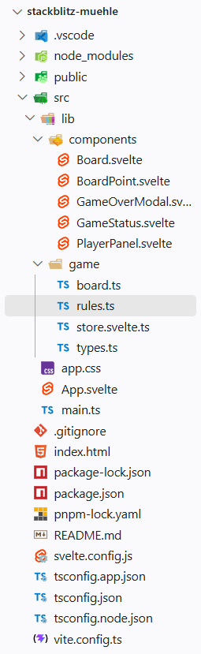

# seiwald-mitschrift

Das ist die README.md-Datei. MD steht für markdown. Markdown ist eine heutzutage weit verbreitete Auszeichungssprache (_Markup Language_, [Wikipedia](https://de.wikipedia.org/wiki/Auszeichnungssprache)).

Weitere bekannte AUszeichungssprachen sind:

- Hypertext Markup Language (HTML)
- Extensible Markup Language (XML)
- Yet Another Markup Language (YAML, YML)

## Installation von Node.js

Javascript läuft unter normalen Umständen in einer Browser Sandbox (nur im Browser).
Seit ca. 2010 gibt es eine Laufzeitumgebung (_Runtime Environment_) für JS, damit man auch Serverseitg JS programmieren und ausführen kann: [Node.js] (https://nodejs.org/).

## Installation von pnpm

Der Standardmäßige _Package Manager_ für Node.js ist `npm` (_node package Manager_). Eine etwas modernere und inzwischen beliebtere Variante ist [`pnpm`] (https://pnpm.io/).

Eine Path-Variable ist eine Umgebungsvariable, die dem Betriebssystem mitteilt, wo es ausführbare Dateien finden kann. Wenn du `pnpm` installierst, wird es normalerweise automatisch zu deiner Path-Variable hinzugefügt, damit du es von überall in der Kommandozeile ausführen kannst.

## Installation von strapi

Installation mit dem Script `pnpm create strapi`.
Daraufhin führt das CLI (_Command Line Interface_) durch die Installation. Falls bei der Installation sogeannte "build scripts` nicht ausgeführt werden können, schlägt die CLI die Fehlerbehandlung selbstständig vor:

1. Wechsel in das Installationsverzeichnis (mit `cd my-strapi-project`).
2. Neuerlicher Versuch der Installation mit `pnpm install`. Dieser scheitert in der Regel - die Build-Skripte müssen mit `pnpm approve-builds` manuell freigegeben werden.

---

# Historische Entwicklung von WebDev

Webdevelopment hat in Laufe der letzten rund 35 Jahre einige Evolutionsstufen durchlaufen:

1. Statische Website (HTML, CSS, ggf. JavaScript) - initiale Form von Webanwendungen, bei der der Inhalt fest im HTML-Code definiert ist. Dominant in den 1990er Jahren.

2. Dynamische Website (mit serverseitiger Programmiersprache - PHP, python, NodeJS - und Datenbankbindung). Dominant in den 2000er Jahren.

3. _Single Page Applications_ (SPAs) mit clientseitigem Rendering (React, Angular, Vue, Svelte). Dominant in den 2010er Jahren.
   Mit Javascript-Frameworks (z.B. React, Angular, Vue, Svelte) erstellte "Webapps", die ähnliche Funktionen wie klassische Desktop-Anwendungen bzw. Handy-Apps bieten. Dominant in den 2010er Jahren. Um Handy-Apps möglichst nahe zu kommen, wurde der _Progressive Web App_ (PWA)-Standard entwickelt. Damit können Webanwendungen offline funktionieren, Push-Benachrichtigungen senden und auf bestimmte native Funktionen des Geräts zugreifen. Es gibt drei Vorraussetzungen die eine Wepapp erfüllen muss, um als PWA zu gelten:
   1. Die Webapp muss über ein Web-App-Manifest verfügen, das grundlegende Informationen über die App enthält (Name, Icons, Start-URL, etc.).

   2. Die Webapp muss über einen Service Worker verfügen, der das Caching von Ressourcen und die Offline-Funktionalität ermöglicht. Ein Service Worker ist eine Javascript Datei, die im Hintergrund läuft - selbst wenn der Browser geschlossen ist.

   3. Die Webapp muss über eine sichere Verbindung (HTTPS) bereitgestellt werden.

Frontend-Frameworks wenden folgende Architekturprinzipien an, um eine möglichst gute _User Experience_ (UX) zu erreichen:

- **Komponenten** - Komponenten sind die wiedervwendbaren "Lego-Bausteine" der Webapp. Sie kapseln HTML, CSS und JavaScript in einer einzigen Einheit, die unabhängig von anderen Komponenten entwickelt und getestet werden kann.
- **Deklarative Programmierung** - der Javascript- und Template(HTML)-Code beschreiben, wie die Benutzeroberfläche aussehen soll, anstatt die Schritte zu definieren, die erforderlich sind, um sie zu erstellen. Das Framework kümmert sich um die Umsetzung, dabei kommt Reactivität ins Spiel: Wenn sich die Daten ändern, aktualisiert das Framework automatisch die Benutzeroberfläche, um den neuen Zustand (_state_) widerzuspiegeln. Wenn die Aktualisierung auch in die andere Richtung funktioniert (d.h. wenn sich die Benutzeroberfläche (UI) ändert, weil der Benutzer mit ihr interagiert und der Zusatand (_state_) der ANwendung entsprechend aktualisiert wird), spricht man von bidirektionaler Datenbindung (_two-way data binding_).
  **Logikbausteine** (Schleifen zur Darstellung von Listen und Bedingungen für das konditionale Ein- und Ausblenden von UI-Elementen) werden in den Templates (HTML) der Komponenten definiert. Die Templates werden vom Framework in die eigentliche Benutzeroberfläche übersetzt. Komponenten können auch andere Komponenten enthalten, wodurch eine hierarchische Struktur entsteht. Die Kommunikation zwischen den Komponenten erfolgt über **Props** (Eigenschaften) und **Events** (Ereignisse). Props sind Daten, die von einer übergeordneten Komponente an eine untergeordnete Komponente weitergegeben werden. Events sind Benachrichtigungen, die von einer untergeordneten Komponente an eine übergeordnete Komponente gesendet werden, um auf Benutzerinteraktionen oder andere Ereignisse zu reagieren.

## VibeCoding / AgenticEngineering mit VS-Code und Github Copilot

Vibecoding passiert in VS-Code in erster Linie über die neu eingeführte Agent View.
Dort können alle Anpassungen des "_Coding Harness_" vorgenommen werden. Wir können unseren Harness mit verscheidenen Methoden anpassen:

- **MCP-Server**:
  MCP steht für _Model Context Protocoll_. Es ist ein Standard der von Anthropic entwickelt wurde. Mithilfe von MCP können Chatbots/LLMs (_Large Language Models_) auf zusätzliche Tools zugreifen, die sie zu Experten in einem bestimmten Themenbreiech machen.

---

# Frontend-Entwicklung

## Ordnerstruktur

Die Ordnerstruktur einer typischen Frontend-Anwedung sieht in etwas so aus:

Der Ordner .vscode enthält Einstellungen für den VS-Code-Editor. Der Ordner 'node*modules' enthält die abhängikeiten oder auch (*dependencies\*) der Anwendung. Das sind jene Pakete, die bei der Entwicklung (_build time_) und/oder bei der Ausführung (_runtime_) der Anwendung benötigt werden. Alle abhängigkeiten sind in der Datei 'package.json' aufeglistet. Außerdem enthält die Datei 'package.json' Infformationen über die Anwendung selbst (Name, Version, Autor, Lizenz, etc.) und Skripte, die bestimmte Aufgaben automatisieren (z.B. das Starten der Anwendung, Testen der ANwendung, Erstellen einer Produktionsversion der Anwendung). Der Ordner 'public' enthält statische Dateien (z.B. Bilder, Fonts, etc.), die direkt vom Browwser unter dem jeweiligen Pfad geladen werden können. Der Ordner 'src' enthält den Quellcode der Anwendung. Die Dateien 'app.css', 'app.svelte' und 'main.ts' sind die Einstiegspunkte der Anwendung (in diesem Fall eine SPA). Sie werden vom Browser als erstes geladen, wenn die entprechende Website aufgerufen wird. Die Datei 'app.css' enthält die globalen Styles der Anwendung. Die Datei 'app.svelte' ist die Hauptkomponente der Anwendung. Sie enthält die Struktur und das Layout der Anwendung. Die Datei 'main.ts' ist der Einstiegspunkt der Javascript/Typescript der Anwendung. Sie initialisiert die Anwendung in der 'App.svelte' und bindet sie an das HTML-Dokument ('index.html' im Root-Ordner).

## Javascript-Frontendentwicklung mit Frameworks (Svelte, React, Vue, Angular)

Frontend-Entwicklung basiert auf Komponenten.

## DOM

DOM = Document Object Model
DOM ist quasi das html.

JS => Daten + Funktionen

Template(Vorlage) <> HTML

<ul>
{for item in List}
<li>{item}</li>
</ul>

## Runes

$state(): für Reactivity, dass die Variablen automatisch aktualisiert werden, wenn sich ihr Wert ändert.

$derived(): für abgeleitete Werte

$effect(): Konstruktor für ein ".svelte"-file (SFC = Single File Component)

## UI, GUI und CLI

- UI (User Interface): Allgemeiner Begriff für die Schnittstelle, über die ein Benutzer mit einem System interagiert.
- GUI (Graphical User Interface): Benutzeroberfläche mit grafischen Elementen wie Buttons, Fenstern und Icons.
- CLI (Command Line Interface): Benutzeroberfläche, die über Texteingaben in der Kommandozeile bedient wird.

## Komponenten

Komponenten sind die Bausteine der Website. Diese sind html, Javascript und CSS.

## aria

ARIA (Accessible Rich Internet Applications) ist eine Sammlung von Attributen, die HTML-Elementen hinzugefügt werden, um die Zugänglichkeit für Benutzer mit Behinderungen zu verbessern. Beispiele sind `aria-label`, `aria-hidden` und `aria-expanded`.

## Stack (Stapel)

- Datenstruktur (LIFO - Last In First Out)
- Server/Software Stack (Operating System, Webserver, Datenbank, Programmiersprache)
- Bereich im RAM(Speicher) einer Anwendung

## Rest-API

Rest-API: REST = Representational State Transfer. Ein Architekturstil für die Entwicklung von Webservices, der auf den Prinzipien von HTTP basiert. RESTful APIs verwenden standardisierte HTTP-Methoden (GET, POST, PUT, DELETE) und Statuscodes, um die Kommunikation zwischen Client und Server zu ermöglichen.

## Kontrollstrukturen

- Schleifen
- Bedingte Verzweigung

## Datenstrukturen

- Arrays
- Objekte (JS) -> key-value-Paare
